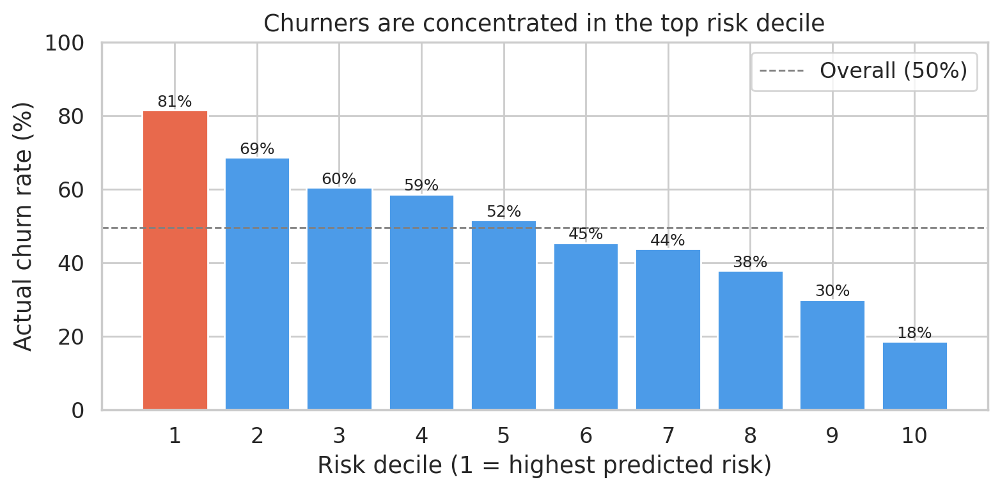
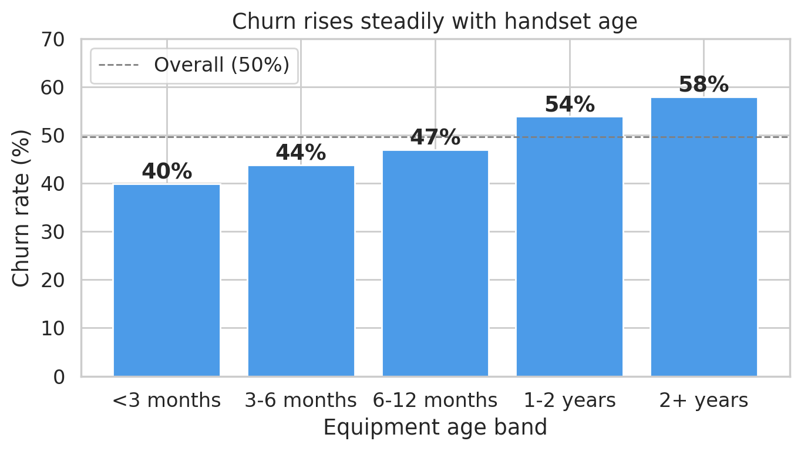
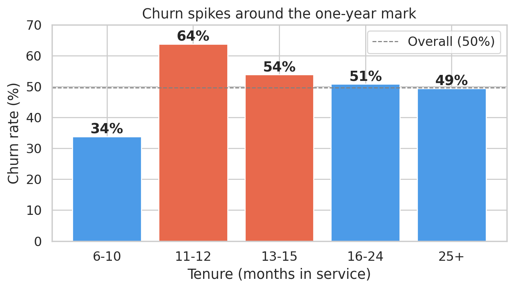
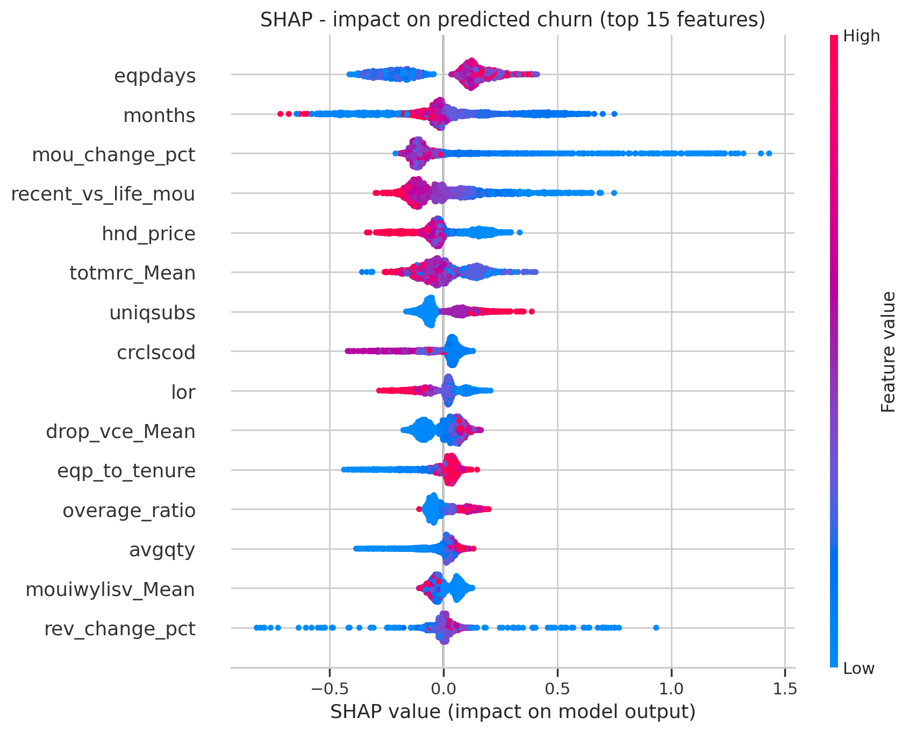
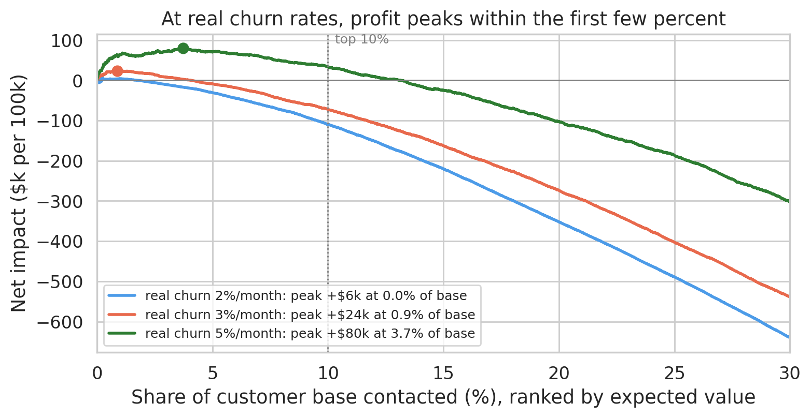

# Telecom Customer Churn Prediction

**Predicting which telecom customers will cancel within 31-60 days, and turning those predictions into a costed retention campaign.**

This was my final project for GCI World 2026 (April cohort). It was framed as a proof-of-concept for an anonymised telecom provider ("Telecom") with 100,000 customers: explore the data, build a model, and deliver a business proposal that executives with no ML background can act on.

|          |                                                                                                 |
| -------- | ----------------------------------------------------------------------------------------------- |
| Notebook | [`telecom.ipynb`](telecom.ipynb): full, reproducible analysis                                  |
| Slides   | [`telecom.pdf`](telecom.pdf) (editable [`telecom.pptx`](telecom.pptx)): the 15-slide proposal |

---

## Summary of results

| Metric                                                   | Value                                                                                             |
| -------------------------------------------------------- | ------------------------------------------------------------------------------------------------- |
| Final model                                              | LightGBM, Optuna-tuned, 5-seed average (102 features)                                             |
| Test AUC-ROC                                             | 0.703 (95% CI 0.696-0.709)                                                                        |
| Validation AUC-ROC                                       | tuned LightGBM 0.704, default LightGBM 0.697, Logistic Regression 0.642, baseline 0.500           |
| Test F1 / Precision / Recall @ 0.5                       | 0.643 / 0.642 / 0.644                                                                             |
| Top-decile precision, as sampled (50% churn)             | 81.5% (95% CI 79.7-83.2%)                                                                         |
| Top-decile precision, corrected to 3% monthly churn      | ~9% (3x the real average)                                                                         |
| Top-10% campaign, net per 100k customers (24 months)     | +$2.4M as sampled, -$0.2M at 3% real churn                                                        |
| Expected-value campaign (contact if corrected p > 13.9%) | +$23k per 100k (0.7% of base contacted); +$270k if the offer costs a quarter of a month's revenue |
| Pilot size for a reliable answer                         | ~490 customers per arm                                                                            |

<p align="center">
  
</p>

---

## Key findings

**1. Handset age is the strongest churn driver.** Churn rises steadily from 40% for phones under 3 months old to 58% for phones over 2 years old. `eqpdays` is also the model's #1 SHAP feature.

**2. Churn nearly doubles at the one-year mark.** Churn is 34% for customers at 6-10 months of tenure and 64% at 11-12 months, which is consistent with 12-month contracts expiring.

<p align="center">
  
  
</p>

**3. Churners leave quietly.** Customers who never call customer care churn *more* (52%) than frequent callers (45%). Falling usage is a warning sign: customers whose minutes dropped by more than 100 churn at 54%, against 47% for stable users. A complaint-driven retention process would miss most churners.

**4. Relative change beats absolute level.** Two engineered ratios, usage change relative to the customer's own 3-month average and recent vs lifetime usage, are the #3 and #4 model features, ahead of every raw usage column.

**5. No single variable separates churners from stayers.** The strongest linear correlation with churn is 0.11. A gradient-boosted model that combines about 100 weak signals clearly outperforms both a well-specified linear model and any single-threshold rule.

<p align="center">
  
</p>

---

## The proposal

Model accuracy isn't the bottleneck here; the economics are. The data is a balanced 50/50 sample, and on it a top-10% campaign looks worth $2.4M per 100k customers. Corrected to a realistic 3% monthly churn rate (prior-shift correction after Saerens et al., 2002, plus reweighting of the test set), only about 9% of that top decile really churn. That is 3x the average, but below the 13.9% break-even for an offer costing a month's revenue, so a fixed top-10% campaign would lose about $0.2M per 100k customers.

<p align="center">
  
</p>

The profitable design:

1. **Score every customer monthly** and contact only those whose expected value is positive: corrected churn probability x retention success x 24 months x their own revenue, minus the offer cost (Elkan, 2001; Verbeke et al., 2012). At current assumptions that is under 1% of the base.
2. **Match the offer to the driver:**

| Track               | Target                                                 | Offer                                       |
| ------------------- | ------------------------------------------------------ | ------------------------------------------- |
| Equipment upgrade   | Positive-value customers with handsets over 1 year old | Early upgrade, device discount, bundle      |
| Pre-renewal loyalty | Positive-value customers at 10-15 months tenure        | Loyalty discount, renewal perk, plan review |

3. **Push down the offer cost.** It matters more than accuracy. At half a month's revenue about 5% of the base is worth contacting; at a quarter of a month, about 29%, for roughly +$270k per 100k.
4. **Run a randomised pilot** (~490 customers per arm, offer vs no offer) to measure the real retention rate and cost per save. That sets the contact threshold and provides the treatment/control data needed for uplift modelling.

---

## Approach

1. **EDA** covering missingness, target balance, segment-level churn rates (equipment age, tenure, credit class, customer-care calls, usage trend) and correlation screening for leakage.
2. **Preparation.** Dropped the identifier, two undefined columns and `ethnic` (see *Responsible modelling*). Engineered seven ratio features: usage and revenue change relative to the customer's own history, recent vs lifetime usage, handset age vs tenure, drop rate and overage ratio. Used a stratified 60/20/20 train/validation/test split, with preprocessing fitted on training rows only.
3. **Models.** Compared a majority-class baseline, Logistic Regression (log-scaled numerics, one-hot categoricals) and LightGBM on the validation set, on both AUC and top-decile precision.
4. **Tuning.** Ran a 30-trial Optuna search, scoring each trial by 5-fold stratified CV with early stopping, then refitted the best configuration at a lower learning rate (Akiba et al., 2019). The winners share heavy feature subsampling and strong L2 regularisation.
5. **Final evaluation.** Averaged five seeds of the tuned model, retrained on train+validation, with the number of trees chosen by CV, and scored once on the untouched test set with bootstrap confidence intervals (Efron & Tibshirani, 1993).
6. **Interpretation.** SHAP `TreeExplainer` on 2,000 test customers (Lundberg & Lee, 2017).
7. **Business impact.** Gains table, reliability check (Niculescu-Mizil & Caruana, 2005), prior-shift correction to a realistic churn rate, three targeting policies (top 10% by risk, top 10% by expected value, everyone with positive expected value), sensitivity to churn rate and offer cost, and a power calculation for the pilot.

---

## Responsible modelling

- **Ethnicity excluded.** The raw data includes an ethnicity code. Using it to decide who receives retention offers would be discriminatory, so it was removed before modelling. Removing it did not reduce AUC (0.6926 with it, 0.6947 without it, in an earlier version of the pipeline).
- **Balanced-sample correction.** A 50% churn rate in one month is far above real-world levels (annual telecom churn is typically 20-40%, about 2-4% a month). The notebook corrects probabilities and campaign figures to an assumed 3% monthly rate, and shows sensitivity from 2% to 5%. Telecom's real rate should replace the assumption.
- **Revenue, not profit.** The impact figures are revenue protected, not margin, and the 30% retention success rate is an assumption for the pilot to test.

---

## Reproducing the analysis

```bash
git clone https://github.com/greenbelt88/<repo-name>.git
cd <repo-name>
pip install -r requirements.txt
# place Client.csv and Record.csv in ./telecom/
jupyter notebook telecom.ipynb      # Kernel > Restart & Run All (~7 min)
```

A single seed (`SEED = 42`) makes every number reproducible. Figures are written to `figures/` as the notebook runs. The Optuna search takes about 45 minutes, so by default the notebook uses its stored result. Set `RUN_SEARCH = True` in Section 6 to re-run it. Assumptions for the business case (real churn rate, retention success, offer cost) live in one `Assumptions` object in `churn/config.py`.

Tested with Python 3.11, pandas 3.0, scikit-learn 1.8, LightGBM 4.7, Optuna 5.0 and SHAP 0.51.

```
.
├── README.md
├── telecom.ipynb        # analysis notebook (narrative + results, with outputs)
├── churn/               # reusable code imported by the notebook
│   ├── config.py        #   seed, paths, column groups, tuned parameters, business assumptions
│   ├── data.py          #   loading, feature engineering, train/val/test split
│   ├── preprocessing.py #   tree preprocessor, logistic-regression pipeline
│   ├── models.py        #   CV early stopping, Optuna search, seed-averaged LightGBM
│   ├── evaluation.py    #   metrics, bootstrap CIs, gains table, SHAP, segment churn rates
│   ├── business.py      #   prior-shift correction, targeting policies, pilot sizing
│   └── plotting.py      #   chart helpers
├── telecom.pdf          # slide deck
├── telecom.pptx         # slide deck (editable)
├── figures/             # charts generated by the notebook
├── pyproject.toml       # black / ruff settings
├── requirements.txt
└── telecom/             # Client.csv and Record.csv
```

---

## Limitations and next steps

- **Moderate signal.** An AUC of 0.70 is typical for billing and usage data alone. Support-ticket text, network-quality logs or competitor pricing would probably add signal.
- **Uplift, not just risk.** The model predicts *who will churn*, not *who an offer would change*. The pilot is designed as a randomised trial so its data can train an uplift model (T-learner, Künzel et al., 2019, evaluated with a Qini curve, Radcliffe, 2007).
- **Assumed economics.** The real churn rate, 30% retention success, 24-month horizon and offer cost are all assumptions, and the business case is more sensitive to them than to the model.

---

## References

Market context

- Gallo, A. (2014). The value of keeping the right customers. *Harvard Business Review*. https://hbr.org/2014/10/the-value-of-keeping-the-right-customers
- ITU (2024). *Facts and Figures 2024: Mobile-cellular subscriptions*. https://www.itu.int/itu-d/reports/statistics/2024/11/10/ff24-subscriptions/
- Nguyen, N. Y., Tran, V. L., & Dao, V. T. S. (2022). Churn prediction in telecommunication industry using kernel Support Vector Machines. *PLOS ONE*, 17(5). https://doi.org/10.1371/journal.pone.0267935

Data

- Neslin, S. A., Gupta, S., Kamakura, W., Lu, J., & Mason, C. H. (2006). Defection detection: Measuring and understanding the predictive accuracy of customer churn models. *Journal of Marketing Research*, 43(2), 204-211. https://doi.org/10.1509/jmkr.43.2.204

Modelling and evaluation

- Ke, G. et al. (2017). LightGBM: A highly efficient gradient boosting decision tree. *NeurIPS*. https://lightgbm.readthedocs.io/
- Akiba, T., Sano, S., Yanase, T., Ohta, T., & Koyama, M. (2019). Optuna: A next-generation hyperparameter optimization framework. *KDD*. https://doi.org/10.1145/3292500.3330701
- Bergstra, J., Bardenet, R., Bengio, Y., & Kegl, B. (2011). Algorithms for hyper-parameter optimization. *NeurIPS*.
- Lundberg, S. M., & Lee, S.-I. (2017). A unified approach to interpreting model predictions. *NeurIPS*. https://shap.readthedocs.io/
- Niculescu-Mizil, A., & Caruana, R. (2005). Predicting good probabilities with supervised learning. *ICML*. https://doi.org/10.1145/1102351.1102430
- Efron, B., & Tibshirani, R. J. (1993). *An Introduction to the Bootstrap*. Chapman & Hall.
- Pedregosa, F. et al. (2011). Scikit-learn: Machine learning in Python. *Journal of Machine Learning Research*, 12, 2825-2830. https://jmlr.org/papers/v12/pedregosa11a.html

Business case and campaign design

- Saerens, M., Latinne, P., & Decaestecker, C. (2002). Adjusting the outputs of a classifier to new a priori probabilities: A simple procedure. *Neural Computation*, 14(1), 21-41. https://doi.org/10.1162/089976602753284446
- Elkan, C. (2001). The foundations of cost-sensitive learning. *Proceedings of IJCAI 2001*.
- Verbeke, W., Dejaeger, K., Martens, D., Hur, J., & Baesens, B. (2012). New insights into churn prediction in the telecommunication sector: A profit driven data mining approach. *European Journal of Operational Research*, 218(1), 211-229. https://www.sciencedirect.com/science/article/abs/pii/S0377221711008599
- Künzel, S. R., Sekhon, J. S., Bickel, P. J., & Yu, B. (2019). Metalearners for estimating heterogeneous treatment effects using machine learning. *PNAS*, 116(10), 4156-4165. https://doi.org/10.1073/pnas.1804597116
- Radcliffe, N. J. (2007). Using control groups to target on predicted lift: Building and assessing uplift models. *Direct Marketing Analytics Journal*, 1, 14-21.
